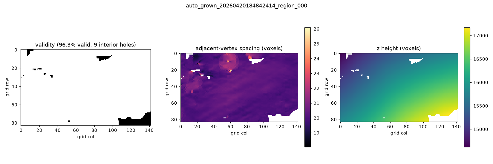

# tifxyz-repair

**Detect *and repair* silent metadata corruption in `tifxyz` surface-mesh patches from the [Vesuvius Challenge](https://scrollprize.org).**

`tifxyz` is the grid-topology mesh format used by [VC3D](https://github.com/ScrollPrize/villa/tree/main/volume-cartographer) and the whole Vesuvius segmentation pipeline: a directory with `x.tif`/`y.tif`/`z.tif` (float32 grids of 3D vertices) plus a `meta.json` sidecar. Metadata in these sidecars can silently go **stale** — and downstream tools then silently drop the affected patches.

This tool's reason for existing is the **repair** half: it detects the [villa #1272](https://github.com/ScrollPrize/villa/issues/1272) stale-bounding-box bug, **fixes** it in place, and ships the upstream C++ fix so it stops recurring.

> **Related work.** [`aviad12g/tifxyz-doctor`](https://github.com/aviad12g/tifxyz-doctor) is an excellent **read-only** diagnostic/preflight for the same format (metadata census, Python/C++ reader differential, sentinel-package detection) — released first, and worth using. `tifxyz-repair` is complementary: it focuses on **repairing** the stale-bbox data loss and on the **root-cause fix upstream in VC3D**, rather than diagnostics alone.

## What it does

| Capability | Detail |
|---|---|
| **Detect stale bboxes** | Re-derives each patch's true bbox from the coordinate grids (matching `QuadSurface::bbox()` semantics exactly) and diffs it against `meta.json`. bbox-based filters (e.g. z-range selection of spiral-fit inputs) **silently drop valid patches** when the stored box is wrong. |
| **Repair them** | `fix` recomputes and rewrites the bbox in place — atomic write (`meta.json.tmp` + rename, like VC3D), `--dry-run`, automatic `meta.json.bak`, or `--strip-bbox` to erase it (mirroring `vc_tifxyz_trim`). Only the `bbox` field is ever touched. |
| **Fix the root cause** | Companion villa PR makes `QuadSurface` recompute the bbox at save time, so the corruption stops being produced (see below). |
| **Guard neighboring failures** | zero/negative voxelsize (the [villa #1226](https://github.com/ScrollPrize/villa/issues/1226) class), NaN/Inf coordinates, `partial-sentinel` vertices (y/z `== -1` while x is not — which VC3D counts as *valid*), malformed bboxes, grid shape/dtype/decoding errors. |
| **Deep geometry inspection** | `inspect`: interior holes, grid-spacing distortion, sheet-switch/merger suspects, normal flips — with defect-map PNGs and a VC3D point-collection export. |

All CPU-only, no GPU required. A full validate pass runs at ~1,000 patches/minute on a 16-core machine.

## Install

```bash
pip install "tifxyz-repair[deep] @ git+https://github.com/Nieuwlaar/tifxyz-repair"
# or from a checkout:
pip install -e ".[deep]"
```

Python ≥ 3.10. Core dependencies: `numpy`, `tifffile`, `imagecodecs`. The `[deep]` extra adds `scipy` + `matplotlib` for `inspect`.

## Usage

### Repair stale bboxes (the headline)

```bash
tifxyz-repair fix verified_patches/ --dry-run   # show what would change
tifxyz-repair fix verified_patches/             # recompute + write (keeps meta.json.bak)
tifxyz-repair fix patch/ --strip-bbox           # or remove bbox (mirrors vc_tifxyz_trim; VC3D recomputes lazily)
```

`fix` only ever touches the `bbox` field; every other byte of `meta.json` is preserved.

### Validate one patch (or a whole tree)

```bash
tifxyz-repair validate path/to/segment.tifxyz
tifxyz-repair validate path/to/patches_dir/        # recurses
tifxyz-repair validate path/to/patch --json        # machine-readable
```

Exit code `0` = clean, `1` = at least one error-severity finding.

```
[  error] verified_patches/auto_grown_20260420184842414_region_000
    ✗ bbox-stale: stored bbox is stale: max drift 439.0 voxels, 5.4% of valid vertices outside the stored box (villa #1272)
```

### Audit a whole corpus in parallel

```bash
tifxyz-repair report verified_patches/ --workers 14 --csv audit.csv --out audit.md
```

### Deep geometry inspection

```bash
tifxyz-repair inspect segment.tifxyz --png-dir defect_maps/
```



*(A real flagged patch from the published corpus: 439-voxel stale bbox, 9 interior holes visible in the validity map.)*

#### Visualize findings in VC3D

```bash
tifxyz-repair inspect segment.tifxyz --export-pointset defects.json
```

Exports the flagged locations — sheet-switch suspects, interior-hole borders, worst stretched cells — as a VC3D point-collection JSON (`vc_pointcollections_json_version` `"1"`, the same format `vc_calc_surface_metrics` consumes; schema documented in [`deep.py`](src/tifxyz_repair/deep.py)). In VC3D, hit **Load** in the Points panel and pick `defects.json`: each patch shows up as `defect_switch_*` / `defect_hole_*` / `defect_stretch_*` collections overlaid at the flagged voxel positions. [`audit/demo_pointset_auto_grown_20260429215626691_sel_20260512_102916_79.json`](audit/demo_pointset_auto_grown_20260429215626691_sel_20260512_102916_79.json) is a ready-made example.

## The upstream fix

The root cause of #1272 is that `QuadSurface::bbox()` caches the box loaded from `meta.json` and only recomputes when unset — so a grid modified after load (e.g. re-optimization) saves the *pre-modification* bbox. The companion villa PR (`1272-bbox-recompute-on-save`) resets that cache in the save path so the bbox is always recomputed from the grid actually being written, with a regression test that fails without the fix. `tifxyz-repair fix` is the cure for already-published data; the PR is the prevention.

## Use as a library

```python
from tifxyz_repair.core import load_patch, compute_bbox
from tifxyz_repair.checks import validate_patch, worst_severity

patch = load_patch("segment.tifxyz")
findings = validate_patch(patch)          # list of {check, severity, message, ...}
assert worst_severity(findings) != "error"
low, high = compute_bbox(patch)           # ground-truth bbox, QuadSurface semantics
```

For maintainers of the affected `spiral-input` corpus: [`audit/corrected_bboxes.json`](audit/corrected_bboxes.json) contains ready-to-apply recomputed bboxes for all 128 stale patches — no need to run anything.

## Semantics: matching VC3D exactly

The reference implementation for this format is C++ (`QuadSurface.cpp` in villa). `tifxyz-repair` mirrors it deliberately:

- **Validity**: a vertex is invalid iff its **x** coordinate `== -1` — VC3D's `QuadSurface::bbox()` tests only channel 0. (That's why `partial-sentinel` vertices, with `-1` in y/z only, are dangerous: VC3D counts them as valid.)
- **bbox**: `[[min_x, min_y, min_z], [max_x, max_y, max_z]]` over valid vertices only.
- **meta.json writing**: indent 4, trailing newline, atomic temp-file + rename — byte-compatible with VC3D's writer.

## Real-world results

Run against the published PHercParis4 `spiral-input` verified-patch corpus (the inputs to whole-scroll spiral fitting; synced 2026-07-30), `tifxyz-repair` confirms and extends the villa #1272 report: **128 of 5,211 patches have stale bboxes** — including the worst known offender (`same_wrap002986_lasagna`, 654-voxel drift, 25.6% of valid vertices outside the stored box) and six patches whose boxes drifted by **10,000–12,566 voxels** in the *over-covering* direction. All 817 published segment meshes across 7 scrolls, by contrast, are clean — scoping the corruption to the patch / re-optimization pipeline. See [`audit/`](audit/) for the full reports and CSV.

## License

MIT
